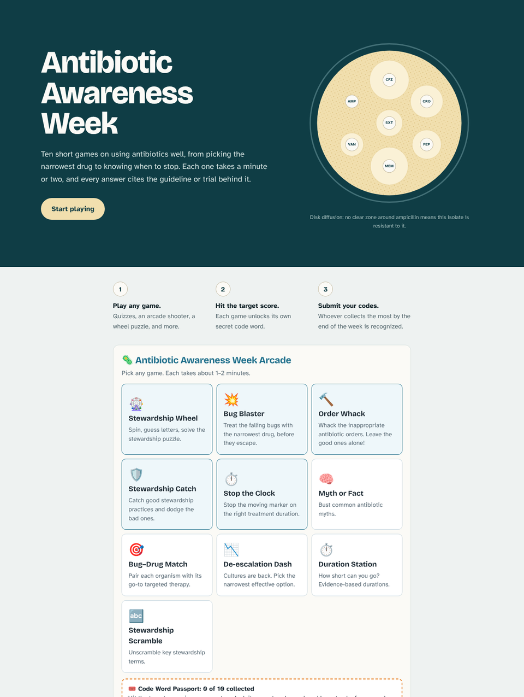

# Antibiotic Awareness Week Arcade

Twelve short, evidence-based games that teach antimicrobial stewardship, built for Antibiotic Awareness Week. Players hit a target score in each game, and the website tracks progress and scores on a leaderboard.

## 🎮 [Play it here: Antibiotic Awareness Week](https://abx-awareness-week.vercel.app/)

No download or sign-up needed. It works on phones and computers.

This project was built with AI tools. Questions, issues, or ideas? Reach out to **Shemual Tsai, PharmD, ID/Stewardship pharmacist**, at [shemual@gmail.com](mailto:shemual@gmail.com).



## The games

| Game | What it teaches |
|---|---|
| Stewardship Wheel | Core stewardship principles, as word puzzles |
| Bug Blaster | Picking the narrowest drug that covers each organism |
| Antibiotic Runner | Spectrum of activity: what common antibiotics do and do not cover |
| Order Whack | Spotting inappropriate antibiotic orders |
| Stewardship Catch | Good practices vs. common pitfalls |
| Stop the Clock | Evidence-based treatment durations |
| Allergy Detective | Penicillin allergy evaluation with the modified PEN-FAST rule, across four patient cases |
| Myth or Fact | Penicillin allergy, asymptomatic bacteriuria, C. difficile testing, MRSA nares |
| Bug–Drug Match | Targeted therapy for common pathogens |
| De-escalation Dash | Narrowing therapy once cultures return |
| Duration Station | Short-course trials (PTC, STOP-IT, Yahav et al.) |
| Stewardship Scramble | Stewardship vocabulary |

Every answer explains the reasoning and cites its source: IDSA, ATS/IDSA, IDSA/SHEA, and ACP guidance, plus key trials such as MERINO, STOP-IT, PTC, BALANCE, and SNAP.

## Two ways to use it

**1. The standalone file.** [`standalone/aaw-arcade.html`](standalone/aaw-arcade.html) is the whole arcade in one self-contained HTML block. It has no dependencies and no outside requests. Paste it into any page that accepts custom HTML (an intranet, LMS, or SharePoint-style site), or just open it in a browser.

**2. The website.** The [live site](https://abx-awareness-week.vercel.app/) loads that same file and adds:
- a player name for everyone, starting as a random antibiotic ("Mighty Meropenem") that players can change
- a live leaderboard in a side panel (the button in the corner): your own progress across all twelve games, the overall standings, and every game's top scores on one scrollable page, in the same order as the arcade, with a Play button on each game
- a private admin page (`/admin`) with the full leaderboard, a CSV export, and per-game play and unlock counts

## Run it for your own team

**Standalone only (5 minutes):**
1. Download `standalone/aaw-arcade.html`.
2. Near the top of the script, change the code words in `CODES` to your own. Optionally, set `FORM_URL` to a form where players submit codes.
3. Paste the whole file into your page.

**Your own website, with submissions (about 15 minutes):**
1. Fork this repo and change `CODES` as above.
2. Import the fork in [Vercel](https://vercel.com). The settings in `vercel.json` are picked up automatically.
3. In the Vercel project, go to Storage, add a **Neon** Postgres database (the free plan is fine), and connect it. Tables are created automatically.
4. Under Settings → Environment Variables, add `ADMIN_KEY` with a long random value, then redeploy.
5. Results are at `/admin`.

## Project layout

```
standalone/aaw-arcade.html   all games, questions, code words, and arcade styles
web/                         the website around the arcade (page, form, admin page)
api/                         serverless functions: submit codes, leaderboard, log plays, admin data
docs/                        README images
```

The website reads the code words from the standalone file, so the list only exists in one place.

## Contributing

Corrections, new questions, and new games are welcome. Open an issue or email [shemual@gmail.com](mailto:shemual@gmail.com).

To make changes:
1. Create a branch and edit `standalone/aaw-arcade.html` (for games) or `web/` (for the website).
2. Open a pull request. Vercel comments a preview link to play-test.
3. Keep the standalone file self-contained: no imports, no outside scripts. If you add a game, give it a code word in `CODES`. Leave the `track(...)` calls and the score passed to `award(...)` in place; the website uses them for tracking and the per-game leaderboards.

To run the website locally (Node.js 22+): `npm install`, then `npm run dev`. Submissions need the deployed site or `vercel dev`.

## Data and privacy

The website stores a player name (a random antibiotic unless the player changes it), the code words they unlock, and anonymous play events (which game was started or finished, tagged with a random per-visit ID). Each browser keeps a random player ID and its codes in local storage so progress survives a reload. There are no accounts, cookies, or third-party analytics, and fonts are served from the site itself. Player names appear on the public leaderboard. The standalone file stores nothing.

Note that the code words are visible in the source of this public repo. Change them if you run a contest of your own.

## Disclaimer

For education only. Content reflects published guidelines and trials at the time of writing and is not a substitute for clinical judgment or local institutional guidance.

## Citing

If you use or adapt this work in teaching or research, please cite it. Citation details are in [`CITATION.cff`](CITATION.cff); GitHub's "Cite this repository" button reads that file.
